<!-- center -->

# Why iroh uses QUIC

Rüdiger Klaehn

n0.computer

---

# Does low-level networking still matter in 2026?

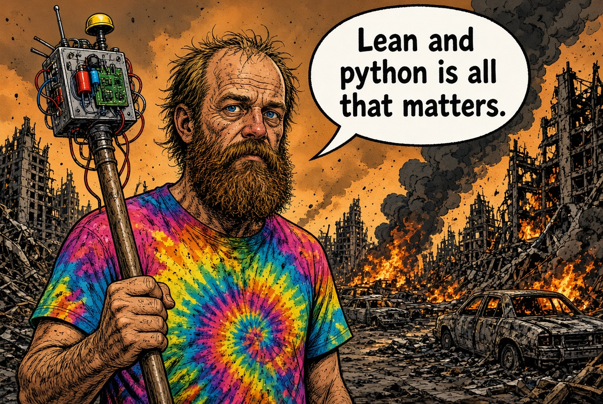

---

# QUIC by the numbers

- **~21%** of web requests use HTTP/3 over QUIC ([Cloudflare Radar 2025])
- **40–58%** of traffic volume on mobile carriers ([Cisco Live 2025])
- IETF standard since 2021 ([RFC 9000]), in every major browser

---

<!-- center -->

# QUIC is TCP over UDP

---

# TCP components

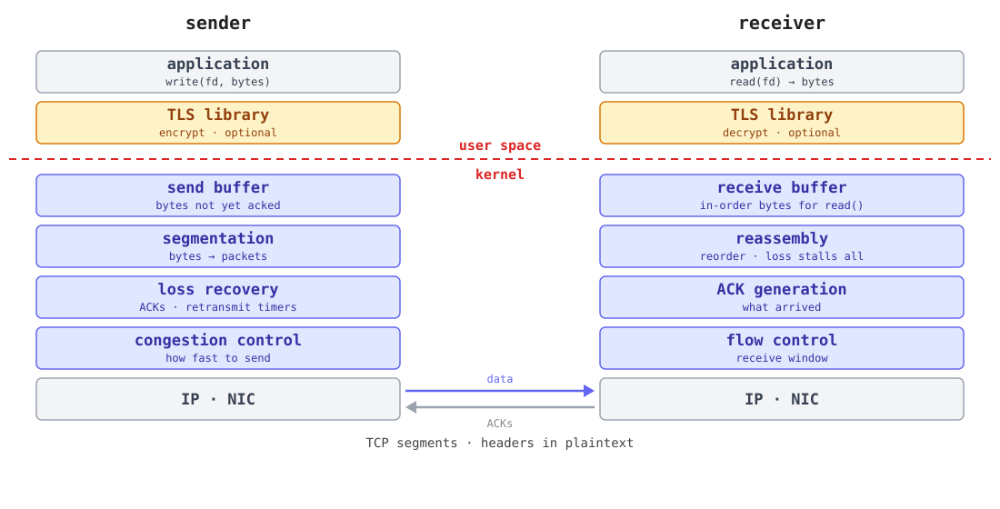

---

# QUIC components

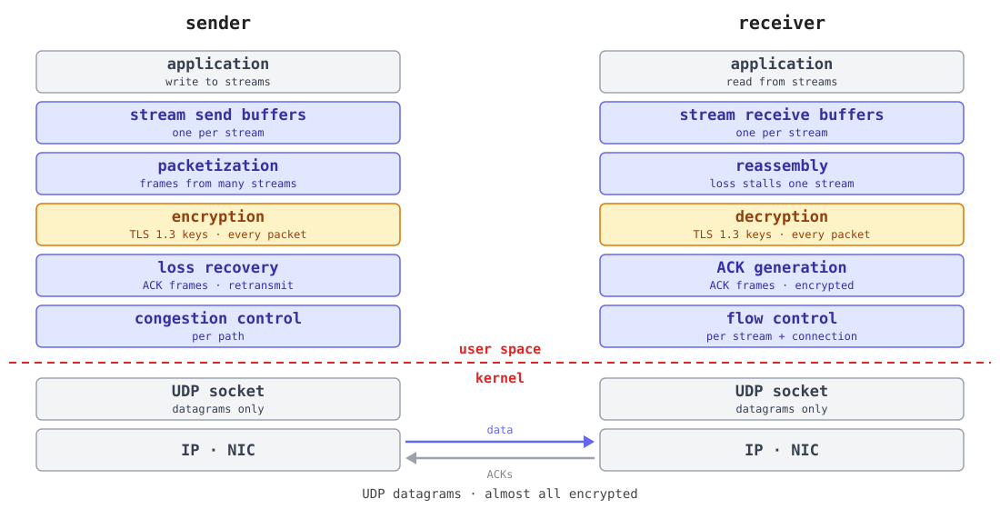

---

# Middleboxes

Anything on the path that looks at your packets

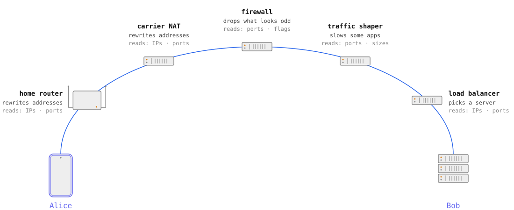

---

# Ossification

- Middleboxes read whatever they can read, and start to rely on it
- What they rely on can no longer change

> With a sufficient number of users of an API, it does not matter what you promise in the contract: **all observable behaviors of your system will be depended on by somebody.**

<a href="https://www.hyrumslaw.com/">Hyrum's Law</a>

---

<!-- center -->

> QUIC is, in effect, the first IETF-defined transport protocol to take care of the minimization of its own wire image to prevent ossification and improve end-to-end privacy by reducing information radiation.

<a href="https://www.rfc-editor.org/rfc/rfc8546">RFC 8546</a>: The Wire Image of a Network Protocol (IAB, 2019)

---

# On the wire

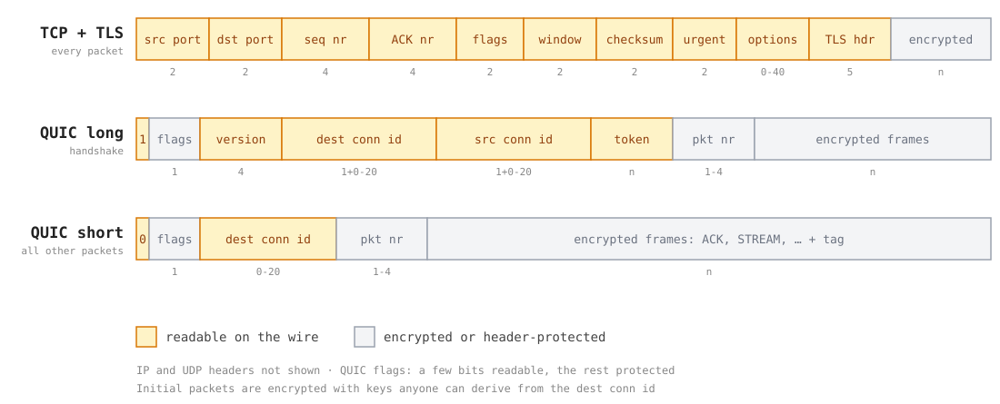

---

<!-- center -->

# iroh is QUIC, but p2p

---


---

# Iroh is p2p QUIC

- a library for **direct QUIC connections**
- works pretty much everywhere
- Rust, with bindings for C, C++, JS, Python, Swift, Go
- Browser works with caveats, but isn't main focus

---

# What makes iroh QUIC connections p2p?

- dial by **key**
- **direct** connections via hole punching

---

# Handshake: HTTPS

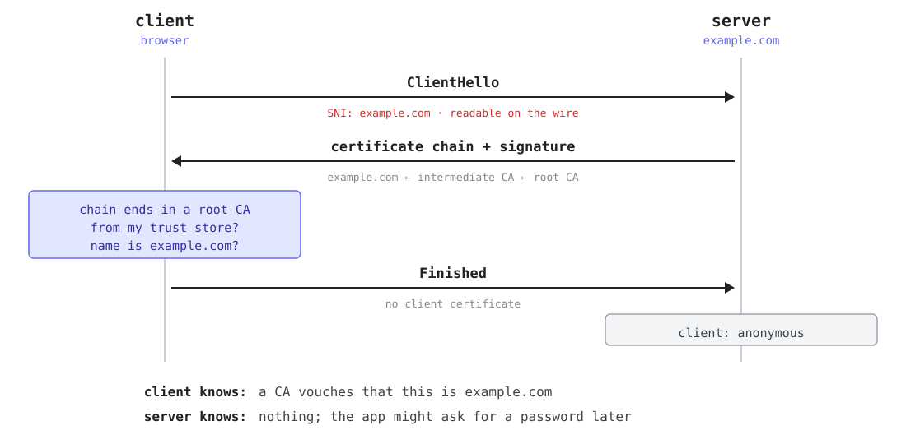

---

# Handshake: iroh (mutual TLS)

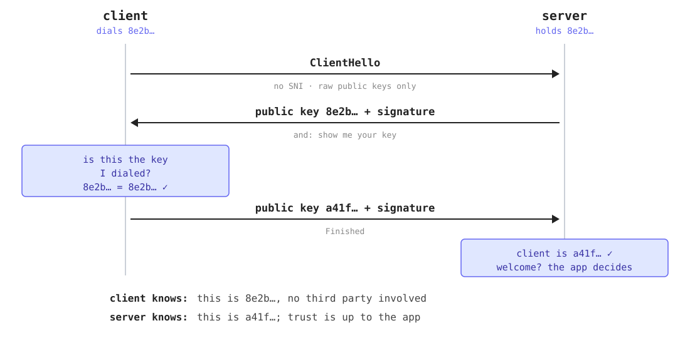

---

# How does it work

Startup

1. Pick a home relay ↻ in the background
2. Advertise your home relay ↻ when it changes

Connect

1. Determine home relay of remote
2. Connect via the remote's home relay
3. Hole punch for a direct connection ↻ in the background

---

# Picking a home relay


---

# Address lookup: DNS


---

# Address lookup: BitTorrent Mainline DHT


---

# Address lookup: mDNS


---

# Hole punching

---

# Iroh architecture

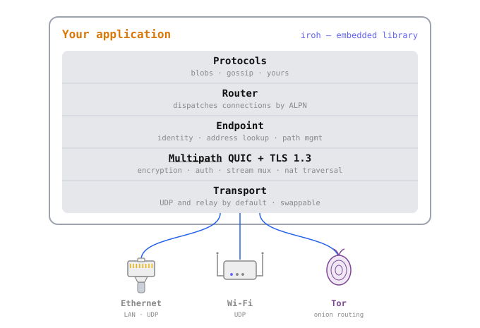

---

# Why iroh uses QUIC

- Why QUIC *on the wire*?
  - Tailscale, Headscale (WG + disco)
  - NetBird, Firezone (WG + ICE)
  - Netmaker, innernet, Talos KubeSpan (WG)
  - ZeroTier (own protocol), Nebula (Noise)
- Why QUIC as the iroh *API*?
  - [HTTP/3]: QUIC *on the wire*, HTTP *API*
  - [MASQUE]: QUIC *on the wire*, VPN/proxy *API*

---

# Why a QUIC API?

- No head of the line blocking between streams
- Stream priorities
- QUIC streams are very cheap


---

# Why a QUIC API?

- Not a new abstraction: a real QUIC connection
- Protocols built on QUIC run on iroh directly, e.g. [Media over QUIC] (IETF WG)
- Reliable streams and unreliable datagrams on one connection
- One ALPN per protocol: many protocols on one endpoint
- Same API whether direct, relayed, or switching paths

---

# Why QUIC on the wire?

- QUIC multipath ([approved draft RFC])
- Congestion controllers *per path*
- No "relearning" during path switches
- CC provide info for path selection


---

# Hole punching

- QUIC extension `N0NatTraversal`
- Inspired by [Using QUIC to traverse NATs] draft RFC (M. Seemann, E. Kinnear)
- `N0NatTraversal` coordination frame types
  - `AddAddress` — advertise a candidate address
  - ~~`PunchMeNow`~~ `ReachOut` — punch towards this address now
  - `RemoveAddress` — retract a candidate address
- The punching itself is standard QUIC path validation: `PathChallenge` / `PathResponse`
- **QUIC protocol evolution in action**: new frames inside the encrypted payload, nothing new for middleboxes to see

---

# Why hole punching inside QUIC?

- One set of cryptographic primitives
- Use QUIC retransmit logic for coordination frames
- HP frames invisible to middleboxes

---

# Why QUIC address discovery (QAD) instead of STUN?

- We already do QUIC connections
- Responses encrypted - untouchable by middleboxes
- Responses authenticated - not spoofable

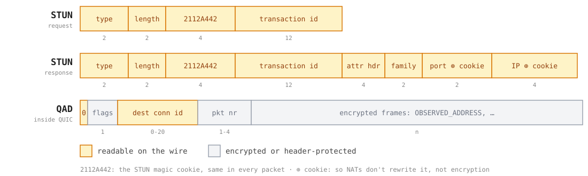

---

# What a middlebox sees

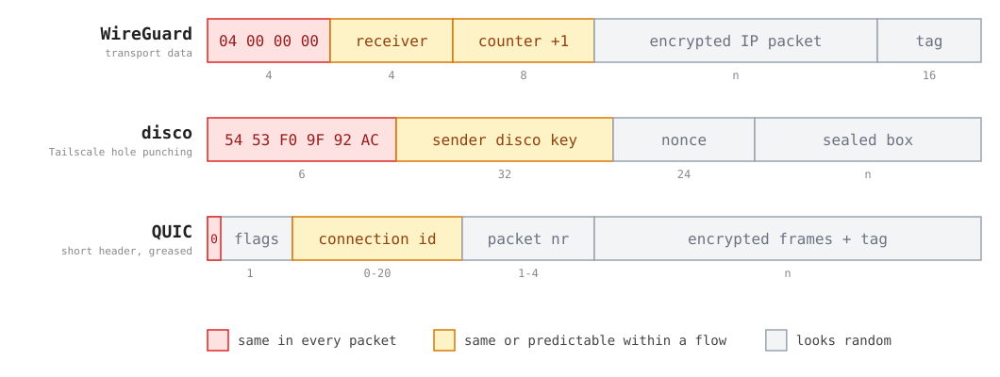

---

# QUIC as the API, QUIC on the wire

- Dial a **key**, not an address: address lookup finds the endpoint
- QUIC API: cheap streams, no head-of-line blocking, priorities
- QUIC wire: multipath, hole punching and address discovery inside the connection
- To a middlebox, it's just QUIC
- Higher level protocols on top: [iroh-blobs], [iroh-gossip]; build your own with [irpc]

---

# Conclusion

- QUIC lives in your app, and is encrypted on the wire
- So unlike TCP, it can still evolve
- iroh shows how far: dial a key, get a direct connection, anywhere
- Build on QUIC, and on iroh if you want p2p

[iroh.computer](https://iroh.computer) · [docs.iroh.computer](https://docs.iroh.computer) · [github.com/n0-computer/iroh](https://github.com/n0-computer/iroh)

[Using QUIC to traverse NATs]: https://datatracker.ietf.org/doc/draft-seemann-quic-nat-traversal/
[approved draft RFC]: https://datatracker.ietf.org/doc/draft-ietf-quic-multipath/
[Media over QUIC]: https://datatracker.ietf.org/wg/moq/about/
[iroh-blobs]: https://docs.rs/iroh-blobs
[iroh-gossip]: https://docs.rs/iroh-gossip
[irpc]: https://docs.rs/irpc
[HTTP/3]: https://www.rfc-editor.org/rfc/rfc9114
[MASQUE]: https://datatracker.ietf.org/wg/masque/about/
[RFC 9000]: https://www.rfc-editor.org/rfc/rfc9000
[Cloudflare Radar 2025]: https://blog.cloudflare.com/radar-2025-year-in-review/
[Cisco Live 2025]: https://www.ciscolive.com/c/dam/r/ciscolive/global-event/docs/2025/pdf/BRKSPM-2024.pdf
